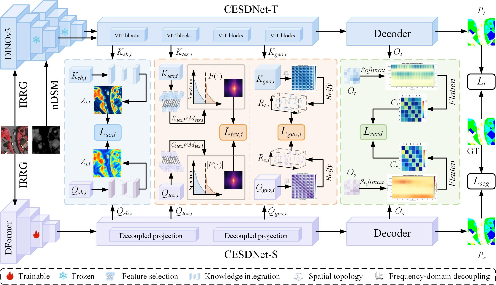
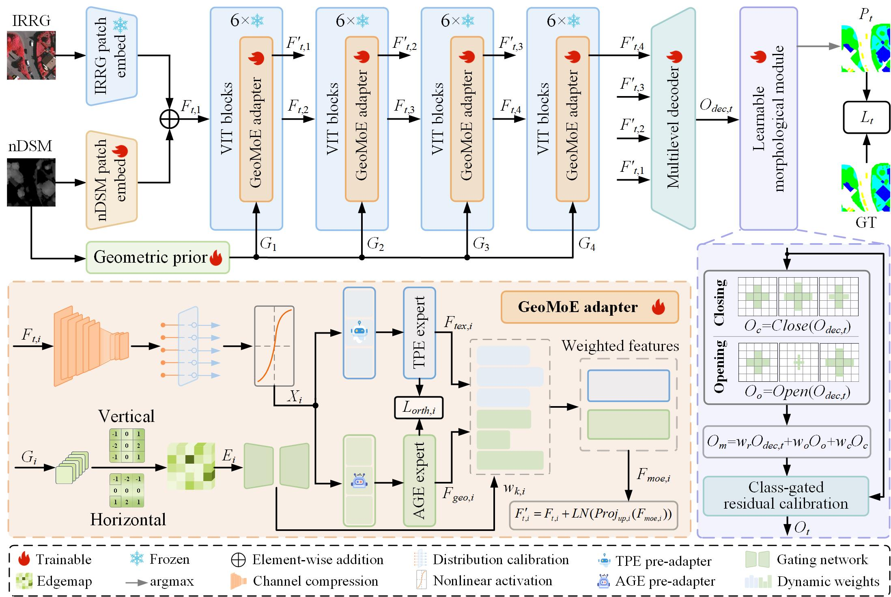

<div align="center">

<h1>Disentangle-Then-Distill: Complementary Expert-Guided Structured Distillation<br>for Remote Sensing Semantic Segmentation</h1>

<p>
  
  
  
</p>

<p>
  <a href="#highlights">Highlights</a> |
  <a href="#architecture">Architecture</a> |
  <a href="#installation">Installation</a> |
  <a href="#training">Training</a> |
  <a href="#results">Results</a>
</p>

</div>

---

## Highlights

- **Disentangle then distill.** GeoMoE uses TPE and AGE to organize complementary texture-oriented and geometry-oriented knowledge before distillation.
- **Structured knowledge transfer.** SCD, CPD, and RCRD transfer shared semantics, expert-specific knowledge, and reliable class relations.
- **Efficient optical-only inference.** CESDNet-KD requires no nDSM at inference and achieves 82.32% / 77.03% mIoU on Vaihingen / Potsdam with 5.39 M trainable parameters.

## Architecture

### Overall Framework

<p align="center">
  
</p>

<p align="center"><sub><strong>Figure 1.</strong> Overall framework of CESDNet.</sub></p>

### Multimodal Teacher: CESDNet-T

<p align="center">
  
</p>

<p align="center"><sub><strong>Figure 2.</strong> Architecture of the dual-expert multimodal teacher CESDNet-T.</sub></p>

## Code Structure

```text
CESDNet/
|-- models/
|   |-- teacher.py                  # CESDNet-T
|   `-- student.py                  # CESDNet-S / CESDNet-KD
|-- toolbox/models/Ourmodel/
|   |-- TPE.py                      # Texture-purification expert
|   |-- AGE.py                      # Adaptive geometry expert
|   |-- GeoMoE.py                   # Expert routing and fusion
|   `-- GMRC.py                     # Operators for geometry calibration branches
|-- losses/structured_kd.py         # SCD, CPD and RCRD
|-- configs/                       # Dataset split definitions
|-- scripts/prepare_isprs.py        # Aligned patch preparation
|-- train_teacher.py
|-- train_student.py
|-- train_kd.py
|-- test.py
`-- eval.py
```

Run every command below from the repository root containing `train_teacher.py`,
`configs/` and `toolbox/`. The checkout folder may have any name.
Both `python train_student.py` and `python -m CESDNet.train_student` are supported.

Follow the steps in order: install dependencies, obtain weights, prepare data,
train the teacher and student, run KD, then validate or test.

## Environment

### Requirements

- Python `3.10`
- PyTorch `2.6.0` and torchvision `0.21.0`
- Other pinned dependencies in `requirements.txt`
- A compatible CUDA GPU for training; `--device cpu` is available for diagnostic runs

### Installation

```bash
conda create -n cesdnet python=3.10 -y
conda activate cesdnet
python -m pip install torch==2.6.0 torchvision==0.21.0 --index-url https://download.pytorch.org/whl/cu124
python -m pip install -r requirements.txt
```

The example selects the CUDA 12.4 PyTorch wheel. Use a wheel compatible with your
platform when a different runtime is required. No MMCV CUDA operators are needed
for the default model.

## Pretrained Models

Data and model weights are supplied separately from the source code.

- **Teacher backbone:** obtain the official **DINOv3 ViT-L/16 LVD-1689M** weights
  through the [DINOv3 pretrained-model instructions](https://github.com/facebookresearch/dinov3#pretrained-models).
  The backbone source is already included in `toolbox/models/dinov3`.
- **Student backbone:** optionally obtain a **DFormer-Tiny** checkpoint from
  [upstream DFormer](https://github.com/VCIP-RGBD/DFormer#2--get-start).
- **CESDNet weights:** [Baidu Netdisk](https://pan.baidu.com/s/1XAEgz_Gyi-DZ_Ec_gN3cUg?pwd=8tbc) (extraction code: `8tbc`)
  Use a compatible local teacher, student or KD checkpoint.
  A complete teacher checkpoint is sufficient for teacher inference or KD without
  separately loading backbone pretraining.

```text
checkpoints/
|-- dinov3_vitl16_pretrain_lvd1689m-8aa4cbdd.pth
`-- dformer_tiny.pth                              # Optional
```

Missing or empty required weight files print an actionable message and stop
before loading data. Incompatible checkpoints are rejected during loading.

| Entry point | Required weight argument |
|---|---|
| `train_teacher.py` | `--teacher-backbone`, or `--resume` for a complete training checkpoint |
| `train_student.py` | `--dformer-weight`, `--no-pretrained` for scratch training, or `--resume` for continuation |
| `train_kd.py` | `--teacher-checkpoint`; initialize the student with `--student-checkpoint`, `--dformer-weight` or `--no-pretrained` |
| `test.py` | `--weights` / `--checkpoint` |
| `eval.py` | `--pred-dir` for saved predictions; no weights are required in this mode |

## Data Preparation

### 1. Arrange the raw data

Keep optical images, normalized nDSM and labels spatially aligned. The expected
relative layout is:

```text
data/ISPRS/
  Vaihingen/
    top/top_mosaic_09cm_area{ID}.tif
    ndsm/dsm_09cm_matching_area{ID}_normalized.jpg
    gts_for_participants/top_mosaic_09cm_area{ID}.tif
  Potsdam/
    3_Ortho_IRRG/top_potsdam_{ID}_IRRG.tif
    1_DSM_normalisation/dsm_potsdam_0{ID}_normalized_lastools.jpg
    5_Labels_all/top_potsdam_{ID}_label.tif
```

The train/validation/test tile IDs are defined in `configs/Vaihingen.json` and
`configs/Potsdam.json`. Keep these splits disjoint and use validation data for
checkpoint selection.

### 2. Prepare patches

Create train/validation patches in a new, empty output directory:

```bash
python scripts/prepare_isprs.py --dataset Vaihingen \
  --source-root data/ISPRS/Vaihingen \
  --output-root data/patches/Vaihingen \
  --patch-size 256 --stride 256 --splits train val
```

For Potsdam, change `--dataset` to `Potsdam` and both corresponding directories.
When labels for all splits are available, use `--splits train val test` during
preparation. Test evaluation requires the matching test labels; validation tiles
must not be substituted for test tiles.

The prepared directory contains `train.txt`, `val.txt` and, when requested,
`test.txt`. Each manifest is CSV with paths relative to the dataset root:

```text
image_path,ndsm_path,label_path
```

The line above describes the row format; manifests do not contain a header row.
Optical-only student manifests may also contain `image_path,label_path` rows.

### 3. Check the input format

- Optical images: three-channel uint8 in **NIR, R, G** order.
- nDSM: aligned, single-channel, normalized uint8. Raw height rasters require
  explicit `--ndsm-max-height` during preparation.
- Both modalities are divided by `255` in the data loader.
- Labels: impervious surface `0`, building `1`, low vegetation `2`, tree `3`,
  car `4`, clutter `5`, and ignored pixels `255`.

The teacher uses IRRG and nDSM. The student uses IRRG only during training and
inference. Training requires both `train.txt` and a separate `val.txt`.

## Training

Paper settings:

- Optimizer: AdamW
- Epochs: `100`
- Learning rate: `1e-4`
- Weight decay: `5e-4`
- Random seed: `3407`
- Batch size: `8` for CESDNet-T; `16` for CESDNet-S and CESDNet-KD

The commands below use Vaihingen. For Potsdam, change the dataset name and its
associated data/checkpoint paths consistently. AMP is optional through `--amp`.

### 1. Train CESDNet-T

```bash
python train_teacher.py --dataset Vaihingen \
  --data-root data/patches/Vaihingen \
  --teacher-backbone checkpoints/dinov3_vitl16_pretrain_lvd1689m-8aa4cbdd.pth \
  --epochs 100 --batch-size 8 --seed 3407 \
  --output-dir outputs/teacher
```

The selected teacher checkpoint is saved as
`outputs/teacher/CESDNet-T-Vaihingen-best.pth`.

### 2. Train CESDNet-S

The following command explicitly initializes the student from scratch:

```bash
python train_student.py --dataset Vaihingen \
  --data-root data/patches/Vaihingen \
  --student-arch cafe --no-pretrained \
  --epochs 100 --batch-size 16 --seed 3407 \
  --output-dir outputs/student
```

To use DFormer-Tiny pretraining, replace `--no-pretrained` with
`--dformer-weight checkpoints/dformer_tiny.pth`.
The selected student checkpoint is saved as
`outputs/student/CESDNet-S-Vaihingen-best.pth`.

### 3. Train CESDNet-KD

Use the teacher and student checkpoints generated in the preceding steps:

```bash
python train_kd.py --dataset Vaihingen \
  --data-root data/patches/Vaihingen \
  --teacher-checkpoint outputs/teacher/CESDNet-T-Vaihingen-best.pth \
  --student-checkpoint outputs/student/CESDNet-S-Vaihingen-best.pth \
  --student-arch cafe --epochs 100 --batch-size 16 --seed 3407 \
  --output-dir outputs/kd
```

The selected deployment checkpoint is saved as
`outputs/kd/CESDNet-KD-Vaihingen-best.pth`. The student requires no nDSM at deployment.

### Short execution check and resume

For a short check, append `--epochs 1 --batch-size 2 --num-workers 0
--max-train-batches 1 --max-val-batches 1` to each training command above.
Use a separate output directory for short checks and pass the corresponding
teacher/student checkpoints to KD. These checks verify execution, not model accuracy.

Full training checkpoints are saved as `CESDNet-T-last.pth`, `CESDNet-S-last.pth`
and `CESDNet-KD-last.pth` in their respective output directories. Resume with
`--resume` and the original recipe/data settings. For example:

```bash
python train_kd.py --dataset Vaihingen \
  --data-root data/patches/Vaihingen \
  --teacher-checkpoint outputs/teacher/CESDNet-T-Vaihingen-best.pth \
  --resume outputs/kd/CESDNet-KD-last.pth \
  --student-arch cafe --epochs 100 --batch-size 16 --seed 3407 \
  --output-dir outputs/kd
```

Use `--help` on each entry point for additional options.

## Testing and Evaluation

### 1. Patch validation

```bash
python test.py --dataset Vaihingen --model kd --mode patch --split val \
  --weights outputs/kd/CESDNet-KD-Vaihingen-best.pth \
  --data-root data/patches/Vaihingen \
  --batch-size 8 --num-workers 0 --output-dir outputs/eval_patches
```

Use `--model student` or `--model teacher` with the matching checkpoint to evaluate
those models. The teacher requires nDSM in addition to the optical image.

### 2. Full-tile inference

```bash
python test.py --dataset Vaihingen --model kd --mode tile --split val \
  --weights outputs/kd/CESDNet-KD-Vaihingen-best.pth \
  --isprs-root data/ISPRS --window-size 256 --stride 256 --batch-size 8 \
  --output-dir outputs/tiles
```

The predictions are saved in `outputs/tiles`. The example explicitly uses a
256-pixel window and stride; keep these settings consistent between compared runs.

### 3. Independently evaluate saved predictions

```bash
python eval.py --dataset Vaihingen --split val \
  --isprs-root data/ISPRS --pred-dir outputs/tiles --metric-mode global
```

This step reads prediction images and labels; it does not require model weights.
Metrics use a global confusion matrix. Clutter ground truth is excluded from
Vaihingen metrics; all six classes are evaluated on Potsdam.

### 4. Evaluate the test split

When the matching test inputs and labels are available, change `--split val`
to `--split test` in the commands above and use a separate prediction directory.
Patch testing additionally requires `test.txt` from data preparation.
For an explicit tile subset, pass the same `--tile-ids` to both `test.py` and
`eval.py`; the result is marked as partial.

Historical unversioned teacher checkpoints require `--architecture-version legacy_v0`.
The legacy Potsdam teacher additionally requires the optional extension described
in `toolbox/models/shift_wiseConv_master/BUILD.md`. Third-party licenses are retained
alongside their sources.

## Results

The following values are reported in the paper for `256 x 256` inputs. **Trainable Params** excludes the frozen DINOv3 backbone. Short execution checks validate the code path; they do not reproduce the accuracy values in this table.

<table>
  <thead>
    <tr>
      <th align="center" rowspan="2"><small>Model</small></th>
      <th align="center" rowspan="2"><small>Input</small></th>
      <th align="center" rowspan="2"><small>Trainable<br>Params (M)</small></th>
      <th align="center" rowspan="2"><small>FLOPs (G)</small></th>
      <th align="center" colspan="2"><small>Vaihingen</small></th>
      <th align="center" colspan="2"><small>Potsdam</small></th>
    </tr>
    <tr>
      <th align="center"><small>mAcc (%)</small></th>
      <th align="center"><small>mIoU (%)</small></th>
      <th align="center"><small>mAcc (%)</small></th>
      <th align="center"><small>mIoU (%)</small></th>
    </tr>
  </thead>
  <tbody>
    <tr>
      <td align="center"><small>CESDNet&#8209;T</small></td>
      <td align="center"><small>Optical + nDSM</small></td>
      <td align="center"><small>100.04</small></td>
      <td align="center"><small>76.54</small></td>
      <td align="center"><small><strong>90.63</strong></small></td>
      <td align="center"><small><strong>83.71</strong></small></td>
      <td align="center"><small><strong>87.22</strong></small></td>
      <td align="center"><small><strong>78.95</strong></small></td>
    </tr>
    <tr>
      <td align="center"><small>CESDNet&#8209;S</small></td>
      <td align="center"><small>Optical only</small></td>
      <td align="center"><small><strong>5.39</strong></small></td>
      <td align="center"><small><strong>2.10</strong></small></td>
      <td align="center"><small>86.10</small></td>
      <td align="center"><small>77.47</small></td>
      <td align="center"><small>83.47</small></td>
      <td align="center"><small>73.97</small></td>
    </tr>
    <tr>
      <td align="center"><small><strong>CESDNet&#8209;KD</strong></small></td>
      <td align="center"><small><strong>Optical only</strong></small></td>
      <td align="center"><small><strong>5.39</strong></small></td>
      <td align="center"><small><strong>2.10</strong></small></td>
      <td align="center"><small>89.86</small></td>
      <td align="center"><small>82.32</small></td>
      <td align="center"><small>85.54</small></td>
      <td align="center"><small>77.03</small></td>
    </tr>
  </tbody>
</table>

## Citation

The paper link and BibTeX will be updated upon publication.

## Acknowledgement

This project builds on [DINOv3](https://github.com/facebookresearch/dinov3) and [DFormer](https://github.com/VCIP-RGBD/DFormer).

Updated some content.
